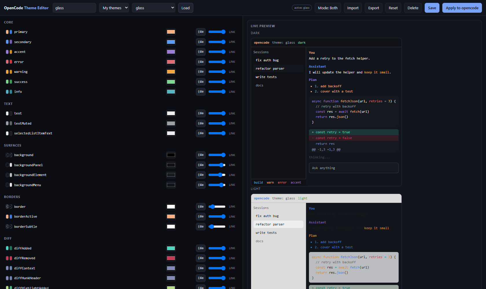

# OpenCode Theme Editor

A small local web app for visually editing [opencode](https://opencode.ai) themes.
Edit every themeable token, see a live preview, and save straight into the folder
opencode actually reads - with automatic backups.



## What it does

- Edits **all 52 colour tokens** opencode supports, plus the numeric `thinkingOpacity`.
- Edits the optional `defs` palette, so tokens can reference named colours.
- **Live preview** of a mock opencode TUI: header, sidebar with a selected list item,
  chat messages, fenced code block, diff hunk, markdown, input box and status line.
- **Dark / light / side-by-side** preview. Every token holds a `dark` and a `light` value.
- **Transparency**: per-token alpha slider (writes 8-digit hex) and an explicit
  transparent option. Transparent surfaces show a checkerboard in the preview.
- **Import** from any of the 33 built-in presets, from a theme you already saved, or
  from a `.json` file / pasted JSON.
- **Export** to a `.json` file.
- **Save** and **Apply to opencode** write to your real opencode config.
- Every overwrite is backed up to `<file>.bak.<timestamp>` first. Nothing is ever
  deleted without a backup.

## Prerequisites

- [Node.js](https://nodejs.org) 18 or newer. Nothing else - zero dependencies.
- Windows, macOS or Linux. (Tested on Windows 11 with PowerShell 5.1.)

## Install

```powershell
git clone https://github.com/vit-cerny/opencode-theme-editor.git
cd opencode-theme-editor
.\start.cmd
```

That starts the server and opens the editor in your browser at
`http://127.0.0.1:4288/`. No build step, no `npm install`.

To also get a Desktop shortcut:

```powershell
powershell -ExecutionPolicy Bypass -File .\install.ps1
```

## Usage

1. Pick a **Preset** (33 built-in opencode themes) or one of **My themes**, then click
   **Load**.
2. Type a name in the top-left box (letters, digits, dot, dash, underscore).
3. Tweak tokens. The preview updates as you go.
   - The colour swatch opens a picker.
   - The text box accepts hex, an ANSI index 0-255, `none`, `transparent`, or a `defs` name.
   - The slider sets alpha.
   - **LINK** edits dark and light together; click it to switch to **SPLIT** and set them
     independently.
4. **Save** writes `<config>/themes/<name>.json`.
   **Apply to opencode** does that and also points `tui.json` at your theme.
5. Restart opencode. Your theme is live.

## Making a transparent theme

opencode accepts **8-digit hex with alpha** (`#RRGGBBAA`) even though the docs only
mention 6-digit hex, and the literal values `none` / `transparent`. See
[`examples/glass.json`](examples/glass.json) for a working glass theme:

```json
{
  "background":        { "dark": "none",      "light": "none" },
  "backgroundPanel":   { "dark": "#0f1115d9", "light": "#ffffffd9" },
  "backgroundElement": { "dark": "#171a21bf", "light": "#f2f4f7bf" },
  "border":            { "dark": "#ffffff26", "light": "#00000026" }
}
```

`d9` is 85% opaque, `bf` is 75%, `26` is 15%.

For the wallpaper to actually show through, your **terminal** must be transparent too.
Windows Terminal, for example:

```json
"opacity": 70,
"useAcrylic": true
```

The theme controls colours; the see-through comes from the terminal compositor.

## Where files go

| Thing | Path |
|---|---|
| Theme you save | `<config>/themes/<name>.json` |
| Theme selection | `<config>/tui.json` -> `{ "theme": "<name>" }` |
| Backups | next to the file, as `<file>.bak.<timestamp>` |
| `<config>` on Windows | `C:\Users\<you>\.config\opencode` |
| `<config>` on macOS/Linux | `~/.config/opencode` (or `$XDG_CONFIG_HOME/opencode`) |

opencode loads themes in this order, later overriding earlier: built-ins, then
`<config>/themes/*.json`, then `<project>/.opencode/themes/*.json`, then
`./.opencode/themes/*.json`.

## Uninstall

```powershell
powershell -ExecutionPolicy Bypass -File .\uninstall.ps1
```

Removes the install folder and the Desktop shortcut. It does **not** touch your themes
or your opencode config.

If you ran it straight from the clone, just delete the folder. To revert a theme you
applied, either set `"theme": "opencode"` in `tui.json`, or restore the backup:

```powershell
Copy-Item "<config>\tui.json.bak.<timestamp>" "<config>\tui.json" -Force
```

## Options

```
node server.js [--port 4288] [--no-open] [--config-dir <path>]
```

- `--port` - port to listen on (default 4288)
- `--no-open` - do not open a browser
- `--config-dir` - override the opencode config directory (useful for testing)

The server binds to `127.0.0.1` only.

## Theme format

```json
{
  "$schema": "https://opencode.ai/theme.json",
  "defs": { "myBlue": "#58a6ff" },
  "theme": {
    "primary": { "dark": "myBlue", "light": "#0969da" }
  }
}
```

Token values may be 6-digit hex, 8-digit hex with alpha, an ANSI index 0-255,
`none` / `transparent`, a `defs` reference, another token name, or a
`{ "dark": ..., "light": ... }` pair. `defs` is optional.

## License

MIT
